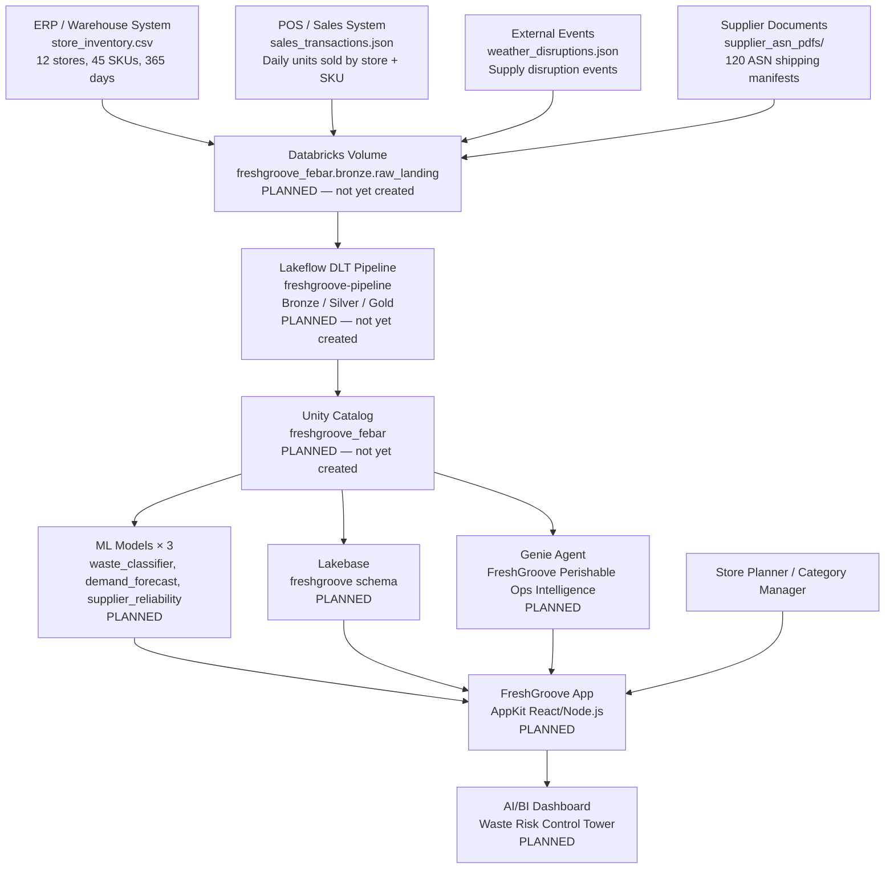

# Architecture — System Context

These diagrams are first-class, versioned artifacts kept in sync with what is actually built. Written in Mermaid — text-diffable and rendered natively by GitHub.

**Sync rule:** Update the affected diagram in the same commit as the build change. A node must not appear unless it maps to a real, deployed resource. Designed-but-not-yet-built items are drawn dashed and labeled as gaps.

## Context Diagram (last updated: Session 1 — stub, no components deployed yet)

Update this diagram after each build phase — replace PLANNED with the actual resource ID.
