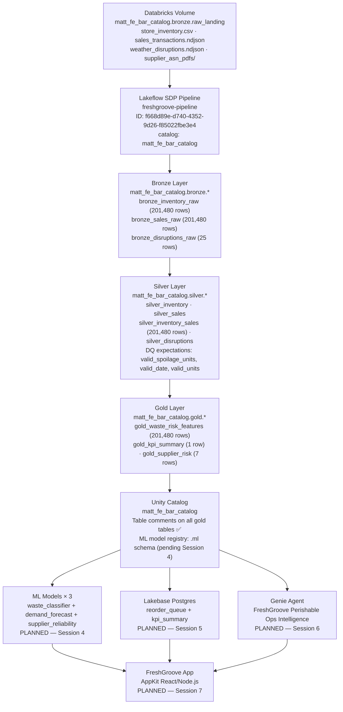

# Container Diagram (last updated: Session 3 — Pipeline deployed and running)

## Deployed Resources

| Resource | ID/Path | Status |
|----------|---------|--------|
| Volume | matt_fe_bar_catalog.bronze.raw_landing | ✅ Live (3 dirs, 3 files) |
| Pipeline | freshgroove-pipeline — `f668d89e-d740-4352-9d26-f85022fbe3e4` | ✅ IDLE/COMPLETED |
| Bronze tables | matt_fe_bar_catalog.bronze.bronze_* (3 tables) | ✅ 201,480 rows |
| Silver tables | matt_fe_bar_catalog.silver.silver_* (4 tables) | ✅ 201,480 rows |
| Gold tables | matt_fe_bar_catalog.gold.gold_* (3 tables) | ✅ Populated |
| UC governance | Table comments on all 3 gold tables | ✅ Applied |

## DQ Expectations (active in silver layer)

- `silver_inventory`: `expect_or_drop("valid_spoilage_units", "spoilage_units >= 0 AND spoilage_units <= on_hand_units")`
- `silver_inventory`: `expect_or_drop("valid_date", "date IS NOT NULL")`
- `silver_inventory`: `expect("store_exists", "store_id IS NOT NULL")`
- `silver_sales`: `expect_or_drop("valid_units", "units_sold >= 0")`
- `silver_sales`: `expect_or_drop("valid_date_sales", "date IS NOT NULL")`
