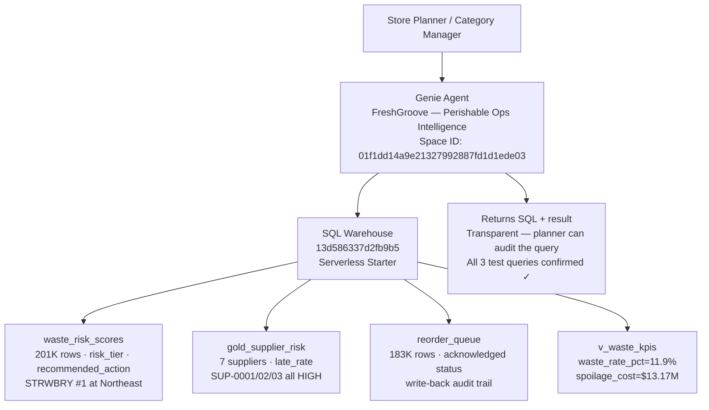

# Agent Architecture — Genie Space (last updated: Session 6)

## Genie Space Configuration

**Space ID:** 01f1dd14a9e21327992887fd1d1ede03
**Title:** FreshGroove — Perishable Ops Intelligence
**Warehouse:** 13d586337d2fb9b5 (Serverless Starter)
**URL:** https://fevm-matt-fe-bar.cloud.databricks.com/genie/rooms/01f1dd14a9e21327992887fd1d1ede03

## Data Sources (7 tables/views)

| Table/View | Rows | Purpose |
|-----------|------|---------|
| gold_waste_risk_features | 201,480 | Full ML feature set, spoilage history |
| waste_risk_scores | 201,480 | Scored SKUs with risk_tier and recommended_action |
| gold_supplier_risk | 7 | Supplier late_rate and avg_spoilage_rate |
| reorder_queue | 183,839 | Operational queue with acknowledged status |
| v_waste_kpis | view | Headline KPIs (waste_rate_pct=11.9%, spoilage_cost) |
| v_high_risk_skus | view | HIGH risk items sorted by score (STRWBRY #1) |
| v_supplier_risk_summary | view | Supplier risk ranking (SUP-0003/02/01 all HIGH) |

## Key Instructions Applied

- Business glossary: waste rate (spoilage_pct), OTIF rate, chargeback, risk tier, reorder queue, strawberry window
- Date window correction: MAX(date)-based, not CURRENT_DATE() (synthetic data ends 2026-03-31)
- SQL transparency rule: always show the query
- 6 sample Q&A pairs with expected SQL patterns
- Unit cost: $45 for perishables

## Validated Test Queries (all 3 return real data ✓)

1. "Which SKUs are at highest risk?" → SKU-STRWBRY top-ranked (187 HIGH flags, 8 stores, SUP-0001)
2. "What is our current waste rate?" → 11.9% (last 30 days of synthetic data, March 2026)
3. "Which suppliers are most unreliable?" → SUP-0003 27.7%, SUP-0002 25.5%, SUP-0001 23.1% (all HIGH)

